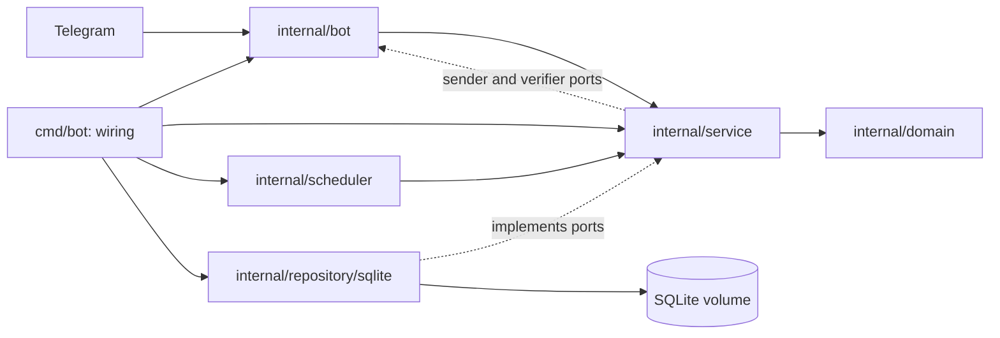

# Архитектура

Telegram-бот для студентов-медиков: задания, сроки, личные отметки, напоминания
и групповые дайджесты. Реализован MVP из утверждённых [плана](docs/plans/2026-10-25-mvp.md)
и [контрактов](docs/contracts/mvp.md). Правила для агентов — AGENTS.md.

## 1. Границы и технологии

Go 1.27.1, telegram-bot-api/v5, SQLite через modernc (CGO_ENABLED=0), embedded
goose-миграции. Один процесс long polling и scheduler, один контейнер с volume.
Интерфейс — команды и кнопки Telegram; HTTP API, web admin, внешний cron и
брокер в MVP не добавляются. Нет оценок/LMS, данных пациентов и multi-tenant SaaS.

## 2. Слои и зависимости

- domain: сущности, enum, входные/выходные типы и sentinel errors; только stdlib.
- service: сценарии, ACL, проверки, планирование, persistent dialogs, доставка;
  интерфейсы потребляемых репозиториев, UnitOfWork и Telegram-портов.
- repository/sqlite: SQL, сканирование, CAS, курсоры и общая транзакция.
- bot: разбор update/callback, русские сообщения, клавиатуры, Telegram API,
  пересылка файлов по file_id, общий rate limiter, безопасные ошибки API.
- scheduler: три отменяемых цикла, вызывающие сервисные порты.
- config: чтение optional .env, приоритет окружения, валидация без сетевых вызовов.
- cmd/bot: конфигурация, миграции, seed admin, сборка зависимостей и shutdown.
- cmd/migrate: применение той же схемы без Telegram и синхронизации ролей.

SQL находится только в repository и migrations, Telegram SDK — только в bot.
Интерфейсы и доменные типы не содержат SDK/sql-типов. Нет глобального клиента
или глобального реестра миграций. Конструкторы получают clock, token generator,
UnitOfWork, отправителя и проверку прав чата.

## 3. Контракты и права

Полные сигнатуры: [docs/contracts/mvp.md](docs/contracts/mvp.md) и
internal/service/interfaces.go. Их изменения проходят Lead и human approval.

Роли: student читает задания своей группы и управляет своими отметками;
editor меняет предметы и задания своей группы; admin глобально управляет
группами и редакторами, выбирая группу явно. Кнопка не считается проверкой прав.
Каждый сервисный метод заново читает пользователя, проверяет роль, членство
и версию объекта. Подмена group_id, subject_id, user_id или cursor не даёт доступа.
Предмет другой группы дополнительно блокируется составным FK.

Источник admin — ADMIN_TELEGRAM_IDS. При старте набор admin синхронизируется
атомарно; исключённые ID становятся student, прочие editor сохраняются.
Через меню выдаётся только editor. Регистрация из личного update меняет имя
и доступность личного чата, сохраняя роль, дату и группу. Привязка из группы
не включает личные отправки и требует уже существующего admin.

Callback закрыт: menu:<section>, tasks:<period>:<cursor>, subject:<id>:<cursor>,
view:<id>, done:<id>:<version>, undo:<id>:<version>, snooze:<id>:<version>:3h,
dlg:<id>:<revision>:<enum-or-id>. До 64 байт, всегда answerCallbackQuery.
ID актора берётся только из Telegram From, а не из callback. Персональная
отметка редактирует текущую личную карточку. Групповые кнопки — deep links в
личный чат с повторной проверкой доступа. Подробности закрытых действий — в плане.

## 4. Модель данных и горячие запросы

Схема: 0001_identity (не изменялась), 0002_learning, 0003_notifications.
[docs/database.md](docs/database.md) описывает поля, ограничения, ER-диаграмму
и назначение каждого индекса. Прикладные timestamps — RFC3339 UTC TEXT,
local_date — календарная дата в TZ. WAL, foreign_keys=ON, busy_timeout=5000
на каждом соединении, пул из одного соединения.

Горячие индексы: users(group_id), subjects(group_id), активное уникальное имя
предмета, assignments(group_id,deadline_at,id), assignments(subject_id),
attachments(assignment_id), reminders(send_at) с частичным условием ожидания,
reminders(user_id,assignment_id), outbox(status,next_attempt_at),
outbox(lease_until) WHERE processing, outbox(user_id,reminder_id),
outbox(digest_run_id), dialog_states(user_id)/expires_at WHERE active,
audit_log(group_id,at,id). Keyset-пагинация заданий по времени и ID.

Связанные записи изменяются через одну UnitOfWork: публикация задания и
напоминаний, завершение мастера, отмена очереди, личные отметки и аудит.
Транзакция не содержит HTTP и не допускает вложенного входа. Сохранение
subject/group/assignment и шага диалога проверяет expected version/revision.

## 5. Интерактивные сценарии

/start → регистрация → меню → /join по коду или deep link. Один пользователь
в одной группе. Смена группы требует выхода с подтверждением, а editor —
предварительного снятия полномочий. История отметок сохраняется.

/admin → группа → предметы, приглашение, редакторы, участники, дайджест, аудит.
Редактор управляет предметами через /subjects manage. Администратор может
читать явную группу через /tasks <groupID> и /subjects <groupID> без членства.
/bind проверяет роль admin бота и права администратора Telegram у отправителя
и бота; допускаются только group/supergroup, один чат на учебную группу.

/add → выбор группы при необходимости → предмет → вид → заголовок → описание
→ будущий дедлайн в TZ → важность → URL → до десяти документов/фотографий →
preview → подтверждение. До подтверждения есть только черновик. Создание не
делает массовую рассылку. /edit проверяет исходную версию; /cancel_task
сохраняет историю. Архивирование предмета скрывает его из нового выбора.

Мастер хранится в dialog_states: один active на пользователя, TTL 30 минут,
новый AUTOINCREMENT ID для каждого запуска, revision CAS, очищенный payload
при completed/cancelled/expired. Сохраняются учебные поля, не исходный update.
Финальная запись и завершение мастера атомарны. /cancel отменяет текущий.

Карточки и previews делятся с учётом UTF-16 лимита Telegram. Текст без parse_mode.
Вложения пересылаются по file_id без загрузки на сервер. Тексты интерфейса
формируются в bot из типизированных результатов сервиса.

## 6. Scheduler и очередь

Планирование при старте и раз в 15 секунд: due reminders и сегодняшний digest.
Один worker постоянно захватывает по одной outbox-записи; при пустой очереди
ждёт до секунды. Просроченные мастера завершаются при старте и раз в минуту.
Все циклы и ожидания прекращаются через context.

Напоминания — только лично. Будущие интервалы берутся из REMINDER_OFFSETS;
создание, вступление, undo и включение настроек не догоняют уже прошедшие.
Изменение задания обновляет version и перепланирует оставшиеся интервалы.
Done, leave, cancel и reminders off закрывают ожидающие отправки. Snooze
отменяет ближайшие до выбранного времени, сохраняя последующие стандартные.
Тихие часы в TZ сдвигают время на конец интервала; после срока не отправляем.
За простой накопившиеся стандартные интервалы объединяются до последнего.
Перед HTTP повторно проверяются версия, срок, членство, done и настройки.

В группе только дайджест: активные дедлайны текущего календарного дня по TZ,
по восемь заданий на часть, без персональных отметок. Пустой результат фиксируется.
После простоя можно отправить сегодняшний, но не прошлые даты. UNIQUE(group,date)
и отдельные event_key/receipts частей предотвращают повторное планирование.
Перепривязка отменяет ожидающие части прежней binding version; уже созданный
сегодня запуск не повторяется автоматически в новом чате.

Outbox: lease 2 минуты с случайным токеном, до пяти попыток, паузы
15/30/60/120 секунд, больший retry_after имеет приоритет. 403 выключает
доступность личного чата до нового личного обращения. Во время HTTP БД свободна;
после ответа ack, reminder.sent_at и digest progress фиксируются вместе.
Просроченный token не может подтвердить новый захват. Лимиты общие с UI:
20 сообщений/с, личный чат 1/с, группа 1/3,1с; ожидание отменяется context.

Подтверждённые события дедуплицированы. Crash между Telegram accept и DB ack
может дать дубль; уже принятый HTTP-запрос нельзя надёжно отозвать. Exactly-once
не обещается. Ошибки хранятся кодами без Telegram description, URL или токена.

## 7. Конфигурация и запуск

Все восемь env-ключей перечислены в .env.example; новые в MVP не добавлены:
BOT_TOKEN, ADMIN_TELEGRAM_IDS, DB_PATH, TZ, DIGEST_TIME, REMINDER_OFFSETS,
LOG_LEVEL, ENV. Правила и значения по умолчанию — в README.md и config.
Процессное окружение имеет приоритет над optional .env, включая явную пустоту;
загрузка не меняет окружение процесса. Ошибки не включают значения секретов.
TZ embedded; Local запрещён. LoadDatabase читает только DB_PATH.

Старт: config → DB → embedded migrations → admin sync → Telegram getMe →
сервисы → polling + scheduler. SIGINT/SIGTERM отменяет HTTP и циклы, ожидает
завершения worker и закрывает БД. 401/409 polling завершают приложение.
Логи через slog: dev text, prod JSON, LOG_LEVEL; исходные сообщения и конфиг
не печатаются. События app_started/app_stopped, handler_failed, scheduler_failed.

Docker Compose для локального запуска собирает один multi-stage образ,
distroless nonroot 65532, /data в постоянном volume, без входящих портов.
Shell в runtime нет. Production registry pull, backup и rollout выполняются
оператором вне агентской сессии; production Compose не изменяется.
CI/deploy-автоматизация в репозиторий не добавляется.

## 8. Проверки и решения

Unit-тесты сервисных проверок с fake repositories, adapter-тесты через
httptest Telegram API, SQLite-интеграция на временных файлах, fake clock и
fake sender. Проверяются роли, чужие группы, stale versions/revisions,
TTL и повторное открытие БД, миграции Up/Down/Up, личные marks, quiet hours,
snooze, отмена, retry_after, блокировка, lease fencing, части дайджеста и rebind.
Сквозной тест проводит роли через команды и кнопки. make test-coverage
считает совокупное покрытие internal/service всеми этими тестами (>=70%).

Решения: [ADR-0007](docs/adr/0007-sqlite-bootstrap.md) — SQLite bootstrap и
упаковка; [ADR-0008](docs/adr/0008-mvp-dialogs-and-delivery.md) — MVP и доставка.
Исторические обозначения ADR-0001–0006 отдельными файлами пока не оформлены.
Новые изменения контрактов требуют плана и human approval; ADR append-only.