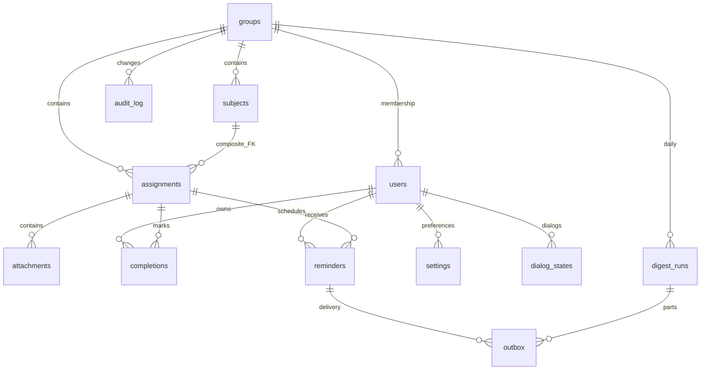

# Схема базы данных

Реализована миграциями `0001_identity.sql`, `0002_learning.sql`,
`0003_notifications.sql`. SQL миграций — источник схемы; существующая 0001
сохранена без изменений. Контракты: [mvp.md](contracts/mvp.md).

## Хранение и транзакции

SQLite через modernc, без CGO. В Docker файл `/data/bot.db`, WAL и SHM находятся
в volume `bot_data`. Монтируется каталог целиком. На каждом соединении включены
`foreign_keys=ON`, `busy_timeout=5000`, WAL; пул ограничен одним соединением.
Прикладные timestamps — TEXT RFC3339 UTC с точностью до секунды; local_date —
YYYY-MM-DD в `TZ`. Внешние Telegram ID хранятся отдельными int64.

Схема применяется embedded goose.Provider с отключённым глобальным реестром.
Одна миграция содержит секции Up/Down. Down проверяется только на временных БД.
Все связанные изменения проходят через `UnitOfWork.WithinTx`: пользователи,
задания, напоминания, диалоги и аудит используют репозитории одной транзакции.
Сетевых вызовов внутри неё нет. `goose_db_version` — служебные метаданные goose.

## Таблицы

| Таблица | Поля и ограничения |
| --- | --- |
| groups | id PK, title, invite_code UNIQUE, created_at, telegram_chat_id NULL UNIQUE < 0, digest_enabled DEFAULT 1, version > 0, chat_binding_version >= 0 |
| users | id PK, telegram_id UNIQUE > 0, display_name, group_id NULL FK, role student/editor/admin, created_at, private_chat_available DEFAULT 0 |
| subjects | id PK, group_id FK, name 1–200, teacher NULL, archived_at NULL, version > 0, created_at, updated_at; UNIQUE(id, group_id); уникальное активное имя в группе |
| assignments | id PK, group_id FK, subject_id, kind, title 1–200, description до 3000, deadline_at, importance, url NULL, created_by FK users, status active/cancelled, version > 0, created_at, updated_at; составной FK(subject_id, group_id) |
| attachments | id PK, assignment_id FK, kind document/photo, file_id, file_name, mime |
| completions | user_id FK, assignment_id FK, done_at; PK(user_id, assignment_id) |
| settings | user_id FK, key reminders_enabled/quiet_start/quiet_end, value; PK(user_id, key) |
| reminders | id PK, assignment_id FK, user_id FK, assignment_version, source default/snooze, offset_seconds NULL, send_at, sent_at NULL, cancelled_at NULL |
| dialog_states | id AUTOINCREMENT PK, user_id FK, kind, step, payload_json, revision > 0, status, expires_at, updated_at; не более одного active на пользователя |
| digest_runs | id PK, group_id FK, local_date, binding_version, status, created_at; UNIQUE(group_id, local_date) |
| outbox | id PK, event_key UNIQUE, kind reminder/digest, reminder_id NULL FK, digest_run_id NULL FK, group_id FK, user_id NULL FK, part, payload_json, status, attempts, next_attempt_at, expires_at, lease_token NULL, lease_until NULL, sent_at NULL, telegram_message_id NULL, last_error_code NULL |
| audit_log | id PK, group_id NULL FK, actor_id NULL FK, action, entity, entity_id, payload_json, at |

Виды задания: homework/test/exam/practice/other; важность: low/normal/high.
Архивирование предмета скрывает его из создания новых заданий. Отмена задания
сохраняет его строку, вложения и личные отметки. Изменение проверяет version.
Имя предмета уникально среди активных в группе после обрезки краевых пробелов;
регистр сохраняется. Вложения содержат только Telegram file_id и метаданные.

Стандартное напоминание уникально по пользователю, заданию, версии и интервалу
среди записей без cancelled_at. Отправленный интервал не создаётся повторно;
отменённый будущий можно снова запланировать после включения настроек.
У snooze нет offset_seconds. Обработка позднего стандартного напоминания
закрывает более ранние накопившиеся интервалы этого задания и пользователя.

Состояния диалога: active/completed/cancelled/expired. Завершение и истечение
очищают payload. ID никогда не переиспользуется. Revision защищает шаг от
повторного callback. В payload только типизированные поля учебного черновика.

Состояния outbox: pending/processing/sent/skipped/failed/cancelled. Processing
обязательно имеет lease_token и lease_until, остальные состояния — NULL.
У reminder есть reminder_id и user_id, у digest — digest_run_id; CHECK
исключает несовместимые комбинации. Подтверждение записи требует актуального
токена и ещё действующего lease. В payload — ID заданий, версия и привязка,
а не готовый текст Telegram. Текст строится из актуальных данных перед отправкой.

Digest run: planning/queued/sent/empty/partial/failed/cancelled. Каждая часть
имеет отдельный event_key. Итог partial означает, что часть сообщений принята,
а оставшиеся завершились иначе. Повторная привязка чата увеличивает только
chat_binding_version и отменяет ожидающие части прежней привязки.

Аудит содержит ID актора, группы и объекта, действие и имена записываемых полей.
Полный текст задания, исходные update, коды приглашений и токены в него не входят.

## Индексы горячих запросов

- users(group_id), UNIQUE telegram_id — членство и идентификация.
- UNIQUE groups(telegram_chat_id) WHERE NOT NULL — единственность привязки.
- subjects(group_id), UNIQUE(group_id,name) WHERE archived_at IS NULL.
- assignments(group_id,deadline_at,id), assignments(subject_id) — списки и дайджест.
- attachments(assignment_id), PK completions(user_id,assignment_id) — карточки.
- reminders(send_at) WHERE sent_at IS NULL AND cancelled_at IS NULL — наступившие сроки.
- reminders(user_id,assignment_id), частичная уникальность стандартных интервалов.
- dialog_states(user_id) UNIQUE WHERE active, expires_at WHERE active — мастер и TTL.
- outbox(status,next_attempt_at), lease_until WHERE processing — доставка и восстановление.
- outbox(user_id,reminder_id), outbox(digest_run_id) — отмена и прогресс частей.
- audit_log(group_id,at,id) — история группы.

Списки используют ограниченный курсор и страницы до 20 записей. Курсор заданий
содержит время и ID сортировки; он не даёт права доступа и не заменяет проверку
группы. Дайджест обходит все страницы и делится по восемь заданий в части.

## Администраторы и регистрация

`ADMIN_TELEGRAM_IDS` остаётся источником глобальных прав admin. При старте
одна транзакция переводит прежних admin в student и назначает текущий список.
Редакторы вне списка сохраняются. Новая запись администратора имеет пустое имя,
NULL group_id и private_chat_available=false. Первое личное обращение заполнит
имя и отметит личный чат доступным, сохраняя роль и created_at.

Вступление по приглашению меняет group_id. Выход и исключение отменяют ожидающие
личные отправки; история отметок сохраняется. Администратор назначает/снимает
только editor. Для исключения или выхода редактора сначала снимаются полномочия.
При 403 личный чат становится недоступным до нового личного обращения.
Групповая команда `/bind` не включает личную доставку.

`make migrate` применяет схему без токена и изменения ролей. Пользовательские
БД агентом не откатываются и не очищаются.

## Проверки

Временные SQLite-файлы: Up/Down/Up, обновление прежней схемы без потери данных,
PRAGMA, ограничения, rollback, версии, ACL, мастера, закрытие/повторное открытие
файла, личные отметки, тихие часы, отмена, snooze, очередь, lease, retry_after,
части дайджеста и перепривязка. Используются вымышленные данные, fake clock и
поддельный отправитель. Данные пациентов и клинические сведения не хранятся.